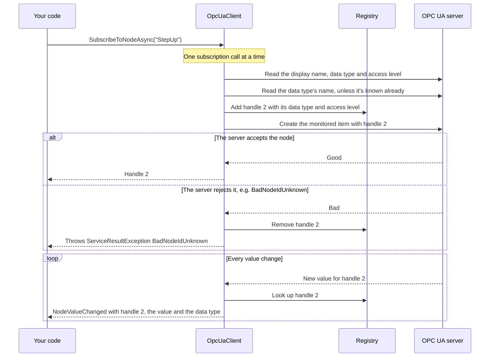
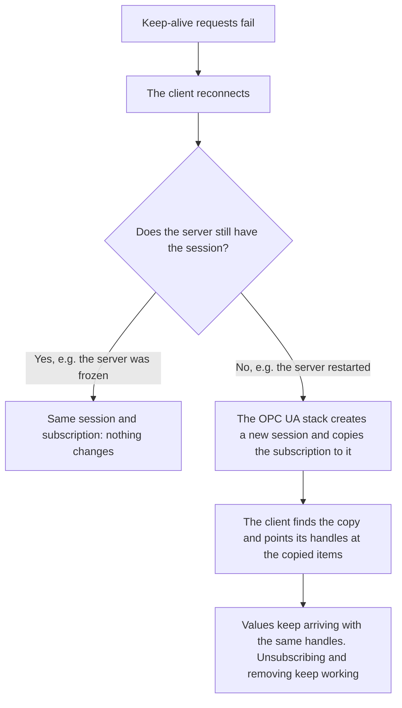
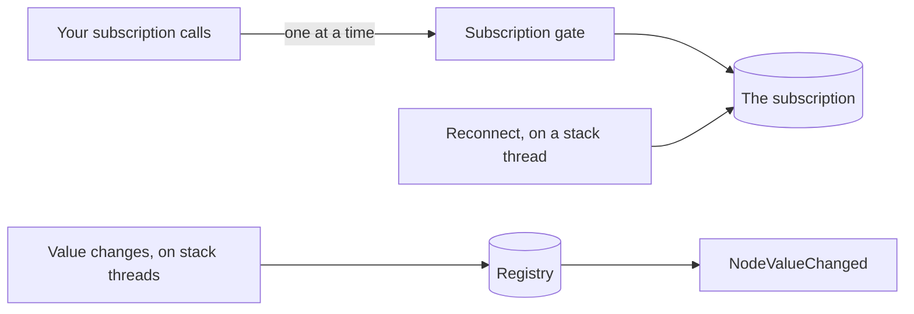

[](https://www.nuget.org/packages/atc.opc.ua)

# Atc.Opc.Ua

A .NET library and CLI tool for OPC UA: connect to servers, read and write nodes, call methods, scan and browse the address space, and monitor values with subscriptions that survive a lost connection.

> Upgrading from 3.x? See [Upgrading to 4.0](#upgrading-to-40).

# Table of Contents

- [Features](#features)
- [Quick Start](#quick-start)
- [OpcUaClient](#opcuaclient)
  - [Dependency injection](#dependency-injection)
  - [When a call fails](#when-a-call-fails)
  - [Reading nodes](#reading-nodes)
  - [Writing nodes and calling methods](#writing-nodes-and-calling-methods)
  - [Reading enum DataTypes](#reading-enum-datatypes)
  - [Subscriptions](#subscriptions)
    - [How subscriptions work](#how-subscriptions-work)
  - [Configuring security](#configuring-security)
  - [Configuring client options](#configuring-client-options)
  - [Keep-alive and reconnect](#keep-alive-and-reconnect)
  - [Best practices](#best-practices)
- [Browsing the address space](#browsing-the-address-space)
- [Scanning the address space](#scanning-the-address-space)
  - [Comparing two scans](#comparing-two-scans)
- [Samples](#samples)
- [CLI Tool](#cli-tool)
  - [Installation](#installation)
  - [Update](#update)
  - [Usage](#usage)
  - [Scanning from the CLI](#scanning-from-the-cli)
  - [Reading enum DataType definitions](#reading-enum-datatype-definitions)
- [Upgrading to 4.0](#upgrading-to-40)
- [Requirements](#requirements)
- [How to contribute](#how-to-contribute)

# Features

- 🔌 **Connect** anonymously or with a username and password, with a self-signed or your own application certificate.
- 🔄 **Keep-alive and reconnect** in the background when the connection is lost.
- 📖 **Read** variables, objects with their children, and enum DataType definitions.
- ✍️ **Write** variables and **call methods**.
- 🗺️ **Scan** the address space into a tree, and **compare** two scans to find added and removed nodes.
- 🌳 **Browse** the address space one level at a time, e.g. for tree views.
- 🔔 **Subscribe** to nodes and receive their value changes. Subscriptions survive a lost connection.
- 💻 **CLI tool** `atc-opc-ua` for the same operations from a terminal, which keeps itself up to date.

# Quick Start

Connect to an OPC UA server, read a node and disconnect:

```csharp
using Atc.Opc.Ua.Services;
using Microsoft.Extensions.Logging;

using var loggerFactory = LoggerFactory.Create(builder => builder.AddConsole());
using var client = new OpcUaClient(loggerFactory.CreateLogger<OpcUaClient>());

await client.ConnectAsync(
    new Uri("opc.tcp://opcuaserver.com:48010"),
    CancellationToken.None);

var nodeVariable = await client.ReadNodeVariableAsync(
    "ns=2;s=Demo.Dynamic.Scalar.Float",
    includeSampleValue: true,
    cancellationToken: CancellationToken.None);

Console.WriteLine(nodeVariable is null
    ? "The node doesn't exist"
    : $"Value: {nodeVariable.SampleValue}");

await client.DisconnectAsync(CancellationToken.None);
```

A failed call throws, e.g. when the server can't be reached; see [When a call fails](#when-a-call-fails).

# OpcUaClient

## Dependency injection

After installing the [NuGet package](https://www.nuget.org/packages/atc.opc.ua), register the services:

```csharp
services.AddLogging();
services.AddOptions();

services.AddTransient<IOpcUaClient, OpcUaClient>();
services.AddTransient<IOpcUaScanner, OpcUaScanner>();
services.AddTransient<IOpcUaNodeBrowser, OpcUaNodeBrowser>();
```

Then use them in your services:

```csharp
public sealed class MyService(IOpcUaClient opcUaClient)
{
    public async Task ReadDataAsync(CancellationToken cancellationToken)
    {
        await opcUaClient.ConnectAsync(
            new Uri("opc.tcp://opcuaserver.com:48010"),
            cancellationToken);

        try
        {
            var nodeVariable = await opcUaClient.ReadNodeVariableAsync(
                "ns=2;s=Demo.Dynamic.Scalar.Float",
                includeSampleValue: true,
                cancellationToken: cancellationToken);

            // Process the data...
        }
        finally
        {
            await opcUaClient.DisconnectAsync(CancellationToken.None);
        }
    }
}
```

## When a call fails

A failed call throws. A read returns `null` only when the node doesn't exist.

| What happened | What's thrown |
|---|---|
| The server reports an error, e.g. a wrong password or a rejected write | `ServiceResultException` from the OPC UA stack. Its `StatusCode` is the server's, e.g. `BadUserAccessDenied`. |
| The call needs a connection, and the client isn't connected | `InvalidOperationException` |
| A node id is missing or invalid, or the node is of another class than the call reads, e.g. an Object read as a Variable | `ArgumentException` |
| Your `CancellationToken` was cancelled | `OperationCanceledException`, with the stack's exception (`BadRequestInterrupted`) as `InnerException` |

```csharp
try
{
    await client.WriteNodeAsync("ns=2;s=Demo.Dynamic.Scalar.Float", 100.5f, cancellationToken);
}
catch (ServiceResultException ex) when (ex.StatusCode == StatusCodes.BadTypeMismatch)
{
    Console.WriteLine("The value's type doesn't match the node's data type");
}
```

One node doesn't fail a call that reads many:

- **A child node that doesn't exist or may not be read** is skipped with a warning when reading an object or scanning, i.e. when reading or browsing it fails with `BadNodeIdUnknown`, `BadUserAccessDenied`, `BadNotReadable`, `BadSecurityModeInsufficient` or `BadAttributeIdInvalid`. Any other failure, e.g. a dropped connection or a timeout, fails the call, so a broken connection doesn't leave out the rest of the tree as skipped. A scan returns the skipped nodes in `SkippedNodeIds`; `ReadNodeObjectAsync` and `ReadNodeVariableAsync` add them to `skippedNodeIds` when you pass a collection.
- **A node that doesn't exist** is left out by `ReadNodeVariablesAsync` and `ReadEnumDataTypesAsync`, with a warning.

## Reading nodes

```csharp
// One variable, with its current value; null when the node doesn't exist
var variable = await client.ReadNodeVariableAsync(
    "ns=2;s=Demo.Dynamic.Scalar.Float",
    includeSampleValue: true,
    cancellationToken: cancellationToken);

// Several variables at once; a node that doesn't exist is left out
var variables = await client.ReadNodeVariablesAsync(
    ["ns=2;s=Demo.Dynamic.Scalar.Float", "ns=2;s=Demo.Dynamic.Scalar.Int32"],
    includeSampleValues: true,
    cancellationToken: cancellationToken);

// An object, with its child objects and variables; null when the node doesn't exist
var nodeObject = await client.ReadNodeObjectAsync(
    "ns=2;s=Demo.Dynamic.Scalar",
    includeObjects: true,
    includeVariables: true,
    includeSampleValues: true,
    cancellationToken: cancellationToken);
```

A variable's `SampleValue` is text formatted with the invariant culture: `21.5`, also on a machine with Danish settings. Date and time values use the round-trip format `O`, e.g. `2026-11-10T20:42:24.0000000Z`. Its type is in `DataTypeOpcUa` and `DataTypeDotnet`.

## Writing nodes and calling methods

```csharp
// One variable. The value's .NET type must match the node's data type, e.g. float for Float.
await client.WriteNodeAsync(
    "ns=2;s=Demo.Dynamic.Scalar.Float",
    100.5f,
    cancellationToken);

// Several variables at once; throws when the server rejects any of the values
await client.WriteNodesAsync(
    new Dictionary<string, object>(StringComparer.Ordinal)
    {
        ["ns=2;s=Demo.Dynamic.Scalar.Float"] = 100.5f,
        ["ns=2;s=Demo.Dynamic.Scalar.Int32"] = 42,
    },
    cancellationToken);

// A method: the object that has it, the method itself, and its arguments; returns its output arguments
var results = await client.ExecuteMethodAsync(
    parentNodeId: "ns=2;s=MyDevice",
    methodNodeId: "ns=2;s=MyDevice.Multiply",
    arguments:
    [
        new MethodExecutionParameter(OpcUaDataEncodingType.Double, "3"),
        new MethodExecutionParameter(OpcUaDataEncodingType.Double, "4"),
    ],
    cancellationToken);
```

## Reading enum DataTypes

The client can read OPC UA enumeration DataType definitions, which is useful for displaying enum options in UIs or mapping numeric values to their symbolic names.

OPC UA enumerations can be defined in two ways:

- **EnumStrings**: a simple `LocalizedText[]` where the array index is the enum value (e.g. `ServerState`).
- **EnumValues**: an `EnumValueType[]` with an explicit Value, Name, DisplayName and Description (e.g. vendor-specific enums).

The client detects and handles both. A node that isn't an enumeration DataType throws `ArgumentException`.

```csharp
// One enum DataType; null when the node doesn't exist
var enumDataType = await client.ReadEnumDataTypeAsync(
    "i=852", // ServerState
    cancellationToken);

if (enumDataType is not null)
{
    Console.WriteLine($"Enum: {enumDataType.Name} ({enumDataType.Members.Count} members)");

    foreach (var member in enumDataType.Members.OrderBy(x => x.Value))
    {
        Console.WriteLine($"  {member.Value} = {member.Name}");
    }
}

// Several enum DataTypes at once
var enumDataTypes = await client.ReadEnumDataTypesAsync(
    ["i=852", "ns=3;i=3063"],
    cancellationToken);
```

`OpcUaEnumDataType` contains:

- `NodeId`, `Name`, `DisplayName`, `Description`: the DataType's metadata.
- `HasEnumValues`: `true` when it's defined with EnumValues, `false` for EnumStrings.
- `Members`: the `OpcUaEnumMember`s with `Value`, `Name`, `DisplayName` and `Description`.

## Subscriptions

Monitor node values with a subscription. The client manages the subscription and its monitored nodes, and raises an event for each value change.

```csharp
using var client = new OpcUaClient(logger);
await client.ConnectAsync(serverUri, cancellationToken);

// Receive value changes
client.NodeValueChanged += (sender, e) =>
{
    if (!e.IsGood)
    {
        Console.WriteLine($"{e.DisplayName}: {e.StatusCodeName}");
        return;
    }

    if (e.TryGetValue<double>(out var number))
    {
        Console.WriteLine($"{e.DisplayName} = {number}");
    }
    else
    {
        Console.WriteLine($"{e.DisplayName} = {e.ValueAsText} ({e.DataTypeName})");
    }
};

// One subscription per client; its options apply to every node it monitors
await client.CreateSubscriptionAsync(
    new SubscriptionOptions
    {
        PublishingIntervalMs = 250,
        SamplingIntervalMs = 250,
        QueueSize = 10,
    },
    cancellationToken);

// Monitor one node; it gets a handle. Throws when the server rejects the node.
var temperatureHandle = await client.SubscribeToNodeAsync("ns=2;s=Temperature", cancellationToken: cancellationToken);

// Monitor many nodes at once, with a result per node
var results = await client.SubscribeToNodesAsync(
    ["ns=2;s=Pressure", "ns=2;s=Flow", "ns=2;s=Level"],
    cancellationToken);

// Each result says whether its node is monitored
foreach (var rejected in results.Where(x => !x.Succeeded))
{
    Console.WriteLine($"{rejected.NodeId}: {rejected.ErrorMessage}");
}

// ... values arrive through NodeValueChanged ...

// Stop monitoring one node, or all of them
await client.UnsubscribeFromNodeAsync(temperatureHandle, cancellationToken);
await client.UnsubscribeAllAsync(cancellationToken);

// Clean up
await client.RemoveSubscriptionAsync(cancellationToken);
await client.DisconnectAsync(cancellationToken);
```

The `MonitoredNodeValue` of each value change has:

- `MonitoredItemHandle`, `NodeId`, `DisplayName`: which node it is.
- `Value`: the value as a .NET value, e.g. `21.5f` for a Float, `true` for a Boolean or a `DateTime` for a DateTime. A LocalizedText is its text, a NodeId its text form, and a structure its text.
- `TryGetValue<T>`: the value as the type you want. It converts when nothing is lost: a whole number to another integer type it fits in, or any number to `double`. A number with decimals is never converted to an integer.
- `ValueAsText`: the value as text, formatted with the invariant culture (`21.5`, also on a machine with Danish settings). Date and time values use the round-trip format `O`.
- `DataTypeName`, `AccessLevel`: the node's data type (e.g. `Float`) and access level, read once when subscribing.
- `ServerTimestamp`, `SourceTimestamp`: when the value was produced and sent.
- `StatusCode`, `StatusCodeName`, `IsGood`: the value's quality, e.g. `Good` or `BadNodeIdUnknown`. `IsGood` checks the severity, so a Good value with extra information, such as the Overflow bit when the queue dropped values, is still Good.

Good to know:

- **One subscription per client.** Its publishing interval, sampling interval and queue size apply to every node it monitors.
- **`SubscribeToNodeAsync` throws when the server rejects the node,** e.g. with `BadNodeIdUnknown` for a node that doesn't exist. With `SubscribeToNodesAsync`, only that node fails: check each result. If the call itself fails, e.g. when the connection drops, it throws, and no node is monitored.
- **Use `SubscribeToNodesAsync` for many nodes.** It needs three round trips to the server, however many nodes there are: one read of the nodes' display names, data types and access levels, one read of data type names it hasn't seen before (usually skipped), and one call that creates all monitored items. Calling `SubscribeToNodeAsync` in a loop costs two or three round trips per node.
- **`NodeValueChanged` is raised on a thread of the OPC UA stack.** Keep handlers short and thread-safe, and hand long work over to another thread.
- **Subscription calls may come from several threads;** they run one at a time.
- **The subscription survives a lost connection,** with the same handles. See [How subscriptions work](#how-subscriptions-work).

### How subscriptions work

| Part | What it is |
|---|---|
| Subscription | One per client, on the server. It has the publishing interval, sampling interval and queue size. |
| Monitored node | A node the subscription watches. The server sends its value changes. |
| Handle | The client's own number for a monitored node, returned by `SubscribeToNodeAsync`. Unique for the client's lifetime. |
| Registry | The client's list of monitored nodes by handle, with the data type and access level read when subscribing. |

The handle belongs to the client, not to the OPC UA stack or the server. That's why it stays the same when the stack replaces its own objects after a reconnect.

**Subscribing and receiving values:**



**After a lost connection.** The client sends keep-alive requests. After a few failed ones (`MaxFailuresBeforeReconnect`), it reconnects:



The registry before and after a server restart:

| Handle | Before: item on the old session | After: item on the new session |
|---|---|---|
| 1 | CurrentTime | CurrentTime, the copy |
| 2 | StepUp | StepUp, the copy |

If the stack couldn't copy the subscription, the client drops it and logs a warning. Call `CreateSubscriptionAsync` again to receive values.

**Threads:**



The [reconnect sample](#samples) shows both reconnect cases against Microsoft's OPC PLC simulator in Docker.

## Configuring security

By default, the `OpcUaClient` creates its own self-signed certificate to present to OPC UA servers. To use your own certificate, configure `OpcUaSecurityOptions`: the certificate stores, the application certificate and other security settings.

> The client creates its certificate stores, including the private key, under `PkiRootPath` relative to the working directory. Keep that folder out of source control, e.g. with `opc/` in `.gitignore`.

The values below are the defaults, except `SubjectName`, which defaults to something like `OpcUaClient [RANDOM_SERIAL_NUMBER]` for the self-signed certificate:

```json
{
  "OpcUaSecurityOptions": {
    "PkiRootPath": "opc/pki",
    "ApplicationCertificate": {
      "StoreType": "Directory",
      "StorePath": "own",
      "SubjectName": "CN=YourApp"
    },
    "RejectedCertificates": {
      "StoreType": "Directory",
      "StorePath": "rejected"
    },
    "TrustedIssuerCertificates": {
      "StoreType": "Directory",
      "StorePath": "issuers"
    },
    "TrustedPeerCertificates": {
      "StoreType": "Directory",
      "StorePath": "trusted"
    },
    "AddAppCertToTrustedStore": true,
    "AutoAcceptUntrustedCertificates": false,
    "MinimumCertificateKeySize": 1024,
    "RejectSha1SignedCertificates": true,
    "RejectUnknownRevocationStatus": true
  }
}
```

```csharp
services
    .AddOptions<OpcUaSecurityOptions>()
    .Bind(configuration.GetRequiredSection(nameof(OpcUaSecurityOptions)))
    .ValidateDataAnnotations()
    .ValidateOnStart();

services.AddTransient<IOpcUaClient, OpcUaClient>();
```

Connecting with a username and password:

```csharp
await opcUaClient.ConnectAsync(
    new Uri("opc.tcp://opcuaserver.com:48010"),
    userName: "myuser",
    password: "mypassword",
    cancellationToken);
```

## Configuring client options

`OpcUaClientOptions` sets the client application's name and the OPC UA session timeout:

```json
{
  "OpcUaClientOptions": {
    "ApplicationName": "MyOpcUaClientApp",
    "SessionTimeoutMilliseconds": 1800000
  }
}
```

```csharp
services
    .AddOptions<OpcUaClientOptions>()
    .Bind(configuration.GetRequiredSection(nameof(OpcUaClientOptions)))
    .ValidateDataAnnotations()
    .ValidateOnStart();
```

The defaults are `ApplicationName` = `OpcUaClient` and `SessionTimeoutMilliseconds` = 1,800,000 (30 minutes).

## Keep-alive and reconnect

The client watches the connection with OPC UA keep-alive requests. After a number of failed requests in a row, it reconnects in the background. Tune or turn this off with `OpcUaClientKeepAliveOptions`; the values below are the defaults:

```json
{
  "OpcUaClientKeepAliveOptions": {
    "Enable": true,
    "IntervalMilliseconds": 15000,
    "MaxFailuresBeforeReconnect": 3,
    "ReconnectPeriodMilliseconds": 10000
  }
}
```

```csharp
services
    .AddOptions<OpcUaClientKeepAliveOptions>()
    .Bind(configuration.GetRequiredSection(nameof(OpcUaClientKeepAliveOptions)))
    .ValidateDataAnnotations()
    .ValidateOnStart();
```

`IsConnected()` tells whether the client has a session, not whether the server still answers. While the connection is down, it stays `true`, calls fail with the stack's status code, e.g. `BadConnectionClosed`, and the client reconnects in the background. `ConnectAsync` does nothing then; to start over instead, call `DisconnectAsync` first. Don't use `IsConnected()` as a health check: the keep-alive warnings below show a connection that's down.

When the session was closed without disconnecting the client, e.g. through the `Session` property, `ConnectAsync` disposes it first, waiting at most 5 seconds for the server, and drops its subscription. Create the subscription again after connecting.

What gets logged:

- **Warning** for each failed keep-alive request until a reconnect starts, and when the reconnect starts.
- **Information** when the session is reconnected, when keep-alive requests succeed again without a reconnect, when a reconnect had to replace the session with a new one (the old one is disposed), and when a subscription is restored on a new session.

## Best practices

- **Pass a `CancellationToken`** to every call. Use `CancellationToken.None` only for work that mustn't be cancelled.

  ```csharp
  using var cts = new CancellationTokenSource(TimeSpan.FromSeconds(30));
  await client.ConnectAsync(serverUri, cts.Token);
  ```

- **Dispose the client**, e.g. with `using`, to release the session and its resources.

- **Catch failures where you can handle them,** e.g. per server in a loop over several, so one unreachable server doesn't stop the others. Disconnect in a `finally`:

  ```csharp
  foreach (var serverUri in serverUris)
  {
      try
      {
          await client.ConnectAsync(serverUri, cancellationToken);
          try
          {
              var scan = await scanner.ScanAsync(client, options, cancellationToken);
              // ...
          }
          finally
          {
              await client.DisconnectAsync(CancellationToken.None);
          }
      }
      catch (ServiceResultException ex)
      {
          logger.LogError(ex, "Scanning {ServerUri} failed", serverUri);
      }
  }
  ```

- **Disconnect explicitly** with `DisconnectAsync` before disposing, for a clean shutdown. It does nothing when the client isn't connected.

- **Reuse a connected client** for many operations, instead of creating a new one each time.

# Browsing the address space

`IOpcUaNodeBrowser` browses the address space one level at a time, e.g. for a tree view that loads as it expands. It uses a connected `IOpcUaClient`. To read a whole part of the address space at once, see [Scanning the address space](#scanning-the-address-space).

```csharp
var browser = new OpcUaNodeBrowser(browserLogger);

// The children of the Objects folder
var children = await browser.BrowseChildrenAsync(
    client,
    "i=85",
    cancellationToken);

foreach (var child in children)
{
    Console.WriteLine($"{child.DisplayName} ({child.NodeClass}) HasChildren={child.HasChildren}");
}

// All attributes of one node; null when the node doesn't exist
var attributes = await browser.ReadNodeAttributesAsync(
    client,
    "ns=2;s=Temperature",
    cancellationToken);

if (attributes is not null)
{
    Console.WriteLine($"Value: {attributes.Value}, Writable: {attributes.IsWritable}");
}
```

# Scanning the address space

`IOpcUaScanner` reads a part of the address space into a tree: a starting object with its child objects and variables.

```csharp
var scanner = new OpcUaScanner(loggerFactory.CreateLogger<OpcUaScanner>());

var result = await scanner.ScanAsync(
    client,
    new OpcUaScannerOptions
    {
        StartingNodeId = "ns=2;s=Demo.Dynamic.Scalar",
        ObjectDepth = 2,
        VariableDepth = 1,
        IncludeSampleValues = true,
    },
    cancellationToken);

// result.Root is the starting object, with its child objects and variables
foreach (var skipped in result.SkippedNodeIds)
{
    // A node that couldn't be read, e.g. without access: it's missing from the tree, or is in it without its children
    Console.WriteLine($"Skipped {skipped}");
}
```

The scan throws when it fails as a whole, e.g. with `BadNodeIdUnknown` when the starting node doesn't exist.

| Option | Default | Description |
|---|---|---|
| `StartingNodeId` | the Objects folder (`i=85`) | Where the scan starts. |
| `ObjectDepth` | 100 | How many levels of child objects to follow. |
| `VariableDepth` | 100 | How many levels of child variables to follow. |
| `IncludeSampleValues` | `false` | Read each variable's current value into `SampleValue`. |
| `IncludeObjectNodeIds`, `ExcludeObjectNodeIds` | empty | Objects to scan, or to skip. |
| `IncludeVariableNodeIds`, `ExcludeVariableNodeIds` | empty | Variables to scan, or to skip. |

The filters are applied while the scan runs, so skipped branches are never browsed. When a node is both included and excluded, it's excluded. An include list works as an allow-list: nodes not on it are skipped.

## Comparing two scans

`NodeTreeDiffer` compares two scans by NodeId, e.g. to find the nodes a server added or removed since the last scan:

A node the current scan skipped looks deleted, though it may still exist, so leave the skipped nodes out of the deleted ones:

```csharp
var comparison = NodeTreeDiffer.Diff(currentScan.Root, previousScan.Root);

// comparison.AddedNodes, comparison.DeletedNodes and comparison.UnchangedNodes
var skipped = currentScan.SkippedNodeIds.ToHashSet(StringComparer.Ordinal);
var deleted = comparison.DeletedNodes.Where(x => !skipped.Contains(x.NodeId));
```

A node in `SkippedNodeIds` can also be one whose children couldn't be browsed; nodes below it are missing from the scan too.

# Samples

| Sample | Shows |
|---|---|
| `sample/Atc.Opc.Ua.Sample` | Reading enum DataTypes, scanning with a variable filter, and reading variables on a timer with reconnect. |
| `sample/Atc.Opc.Ua.Subscription.Sample` | Browsing, reading attributes, subscribing and unsubscribing. |
| `sample/Atc.Opc.Ua.Reconnect.Sample` | A subscription surviving a frozen and a restarted server. |

The first two connect to a local server at `opc.tcp://127.0.0.1:49320`. The reconnect sample uses Microsoft's OPC PLC simulator in Docker:

```powershell
docker run -d --name opcplc -p 50000:50000 mcr.microsoft.com/iotedge/opc-plc:2.15.11 --pn=50000 --autoaccept --ut --ph=localhost
dotnet run --project sample/Atc.Opc.Ua.Reconnect.Sample -- --docker
```

With `--docker`, it freezes and restarts the container itself, and checks that the values come back and that unsubscribing and removing still work. Without it, it monitors until Ctrl+C, and you run `docker pause opcplc`, `docker unpause opcplc` or `docker restart opcplc` yourself.

# CLI Tool

`atc-opc-ua` is a cross-platform command-line tool for the same operations.

## Installation

Install it as a .NET global tool; it needs the .NET 10 runtime:

```powershell
dotnet tool install --global atc-opc-ua
```

Or follow the instructions on [NuGet](https://www.nuget.org/packages/atc-opc-ua/) to install a specific version.

## Update

The CLI keeps itself up to date. When a command starts, it checks NuGet for a newer version, at most once a day. When there is one, it runs `dotnet tool update --global atc-opc-ua` itself, and the new version is used from the next run. If that fails, it prints the command to run yourself:

```powershell
dotnet tool update --global atc-opc-ua
```

To skip the check, add `--no-update-check` to the command, or set `ATC_OPC_UA_NO_UPDATE_CHECK=1`. It never runs on CI, i.e. when `CI`, `TF_BUILD` or `GITHUB_ACTIONS` is set.

## Usage

Run `atc-opc-ua --help` for the commands; every command has its own `--help` too:

```powershell
atc-opc-ua --help

USAGE:
    atc-opc-ua.exe [OPTIONS] <COMMAND>

EXAMPLES:
    atc-opc-ua.exe testconnection -s opc.tcp://opcuaserver.com:48010
    atc-opc-ua.exe testconnection -s opc.tcp://opcuaserver.com:48010 -u username -p password
    atc-opc-ua.exe testconnection -s opc.tcp://opcuaserver.com:48010 --no-update-check
    atc-opc-ua.exe node scan -s opc.tcp://opcuaserver.com:48010 --starting-node-id "ns=2;s=Demo.Dynamic.Scalar" --object-depth 2 --variable-depth 1
    atc-opc-ua.exe method execute -s opc.tcp://opcuaserver.com:48010 --parent-node-id "ns=2;s=Demo.Method" --method-node-id "ns=2;s=Demo.Method.Multiply" --data-types double --data-values 3 --data-types double --data-values 4

OPTIONS:
    -h, --help    Prints help information

COMMANDS:
    testconnection    Tests if a connection can be made to a given server
    node              Operations related to nodes
    method            Operations related to methods
```

Every command, with an example. Add `-u <username> -p <password>` to any of them to connect with a username:

| Command | What it does |
|---|---|
| `testconnection` | Tests if a connection can be made to the server. |
| `node read object` | Reads an object with its child objects and variables. |
| `node read variable single` / `multi` | Reads one or more variables. |
| `node read datatype single` / `multi` | Reads one or more enum DataType definitions. |
| `node write variable single` | Writes a value to a variable. |
| `node scan` | Scans part of the address space into a tree. |
| `method execute` | Calls a method with arguments. |

```powershell
atc-opc-ua testconnection -s opc.tcp://opcuaserver.com:48010
atc-opc-ua node read object -s opc.tcp://opcuaserver.com:48010 -n "ns=2;s=Demo.Dynamic.Scalar"
atc-opc-ua node read variable single -s opc.tcp://opcuaserver.com:48010 -n "ns=2;s=Demo.Dynamic.Scalar.Float"
atc-opc-ua node read variable multi -s opc.tcp://opcuaserver.com:48010 -n "ns=2;s=Demo.Dynamic.Scalar.Float" -n "ns=2;s=Demo.Dynamic.Scalar.Int32"
atc-opc-ua node read datatype single -s opc.tcp://opcuaserver.com:48010 -n "i=852"
atc-opc-ua node write variable single -s opc.tcp://opcuaserver.com:48010 -n "ns=2;s=Demo.Dynamic.Scalar.Float" -d float --value "100.5"
atc-opc-ua node scan -s opc.tcp://opcuaserver.com:48010 --starting-node-id "ns=2;s=Demo.Dynamic.Scalar" --object-depth 2 --variable-depth 1
atc-opc-ua method execute -s opc.tcp://opcuaserver.com:48010 --parent-node-id "ns=2;s=Demo.Method" --method-node-id "ns=2;s=Demo.Method.Multiply" --data-types double --data-values 3 --data-types double --data-values 4
```

## Scanning from the CLI

`node scan` builds the object and variable tree from a starting node (default: the Objects folder):

```powershell
atc-opc-ua node scan -s opc.tcp://opcuaserver.com:48010 --starting-node-id "ns=2;s=Demo.Dynamic.Scalar" --object-depth 2 --variable-depth 1 --include-sample-values
```

Key options:

- `--starting-node-id`: the starting object (the Objects folder when omitted or empty).
- `--object-depth`: how deep to follow objects (0 = only the starting object). Default 1.
- `--variable-depth`: how deep to follow nested variables (0 = only direct variables). Default 0.
- `--include-sample-values`: read a value for each variable.
- `--include-object-node-id`, `--exclude-object-node-id`: objects to scan, or to skip. Repeatable.
- `--include-variable-node-id`, `--exclude-variable-node-id`: variables to scan, or to skip. Repeatable.

The filters work as in [Scanning the address space](#scanning-the-address-space). For example, only one variable, and skipping an object:

```powershell
atc-opc-ua node scan -s opc.tcp://opcuaserver.com:48010 --starting-node-id "ns=2;s=Demo.Dynamic.Scalar" --include-variable-node-id "ns=2;s=Demo.Dynamic.Scalar.Float" --exclude-object-node-id "ns=2;s=Unwanted.Object"
```

## Reading enum DataType definitions

```powershell
# One enum DataType (e.g. ServerState)
atc-opc-ua node read datatype single -s opc.tcp://opcuaserver.com:48010 -n "i=852"

# Several enum DataTypes
atc-opc-ua node read datatype multi -s opc.tcp://opcuaserver.com:48010 -n "i=852" -n "ns=3;i=3063"
```

The output is a table of the enum's members with their Value, Name, DisplayName and Description.

# Upgrading to 4.0

4.0 requires .NET 10, throws on failures instead of returning tuples, adds subscriptions and address space browsing, and changes how values are formatted and how reconnects are logged. Go through this list when you upgrade from 3.x.

## Changes that need code changes

**.NET 10 is required.** 4.0 targets `net10.0` (3.x targeted `net9.0`). The CLI tool needs the .NET 10 runtime.

**Failures throw instead of returning `(Succeeded, …, ErrorMessage)`.** Every method of `IOpcUaClient`, `IOpcUaScanner` and `IOpcUaNodeBrowser` returns its result, or a `Task`, and throws when it fails; a read returns `null` only for a node that doesn't exist. See [When a call fails](#when-a-call-fails).

```csharp
// 3.x
var (succeeded, nodeVariable, errorMessage) = await client.ReadNodeVariableAsync(nodeId, includeSampleValue: true);

// 4.0: throws on failure; null when the node doesn't exist
var nodeVariable = await client.ReadNodeVariableAsync(nodeId, includeSampleValue: true);
```

**`ScanAsync` returns the tree and the skipped nodes.** `NodeScanResult` is `(Root, SkippedNodeIds)`; `Succeeded` and `ErrorMessage` are gone. When comparing scans, leave the skipped nodes out of the deleted ones, see [Comparing two scans](#comparing-two-scans).

**`ReadNodeObjectAsync` and `ReadNodeVariableAsync` have a new optional `skippedNodeIds` parameter** before `cancellationToken`. A call that passes the token by position doesn't compile; pass it by name, `cancellationToken: ct`.

**Your own implementations of `IOpcUaClient`** get new members: `Session`, `NodeValueChanged`, `CreateSubscriptionAsync`, `RemoveSubscriptionAsync`, `SubscribeToNodeAsync`, `SubscribeToNodesAsync`, `UnsubscribeFromNodeAsync` and `UnsubscribeAllAsync`. Add them to your implementation. Mocks, e.g. with NSubstitute, need no change.

## Changes in behaviour

**Sample values use the invariant culture.** In 3.x, `NodeVariable.SampleValue` was formatted with the machine's culture, e.g. `21,5` on Danish settings. In 4.0 it's `21.5` everywhere, and date and time values use the round-trip format `O`, e.g. `2026-11-10T20:42:24.0000000Z`. An app that runs with the invariant culture, as containers usually do, only sees the change for dates and times.

**The CLI updates itself.** When a command starts, it checks NuGet for a newer `atc-opc-ua` once a day, and installs it with `dotnet tool update --global`. Add `--no-update-check` to skip it. See [Update](#update). It also prints a new startup banner instead of the text header.

**A child node that doesn't exist or may not be read is skipped** with a warning, instead of failing the whole read or scan. Any other failure, e.g. a dropped connection, still fails it.

**Cancellation throws `OperationCanceledException`.** In 3.x, a cancelled call returned `(false, message)`.

**`WriteNodesAsync` checks every node.** In 3.x, only the first node's result was checked.

**The CLI exits with 1 when a command fails,** e.g. when a node doesn't exist. In 3.x, only a failed connection did that.

**Keep-alive and reconnects are logged at Warning and Information.** In 3.x, failed keep-alive requests and reconnects were logged at Trace, so they didn't show by default. See [Keep-alive and reconnect](#keep-alive-and-reconnect).

**Failures aren't logged by the library.** The exception carries the error; log it where you catch it. The event ids of the removed failure logs aren't used anymore, and 10047 ("Skipped node …") is a Warning instead of an Error.

**A variable without a value is logged at Debug.** In 3.x, a null value with a Good status, e.g. of a variable of the Null data type, logged the warning "Could not retrieve value" on every read and scan.

# Requirements

- [.NET 10 SDK](https://dotnet.microsoft.com/en-us/download/dotnet/10.0)
- [OPCFoundation.NetStandard.Opc.Ua](https://www.nuget.org/packages/OPCFoundation.NetStandard.Opc.Ua) 1.5.377.21

# How to contribute

[Contribution Guidelines](https://atc-net.github.io/introduction/about-atc#how-to-contribute)

[Coding Guidelines](https://atc-net.github.io/introduction/about-atc#coding-guidelines)
