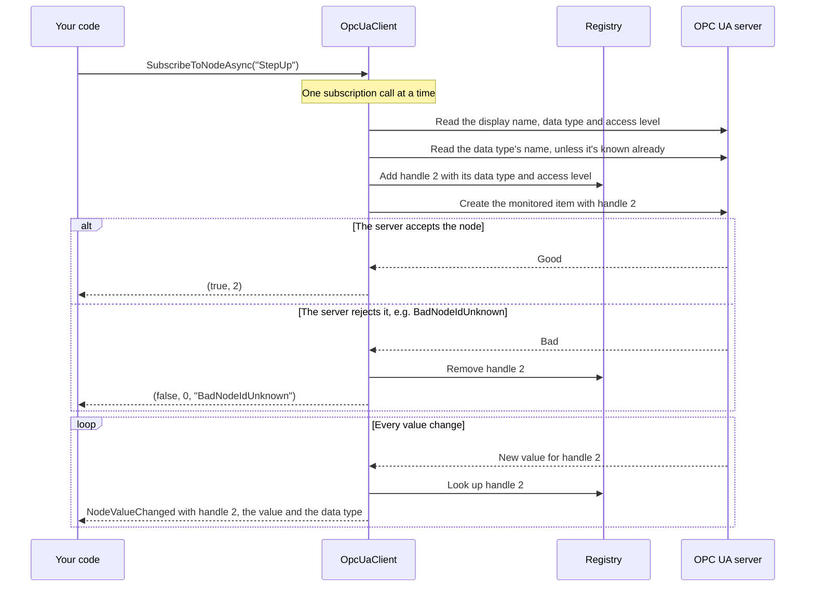
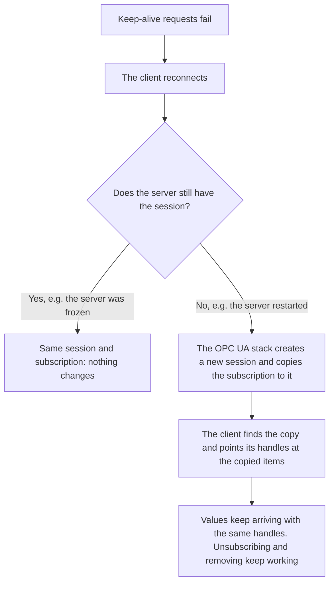
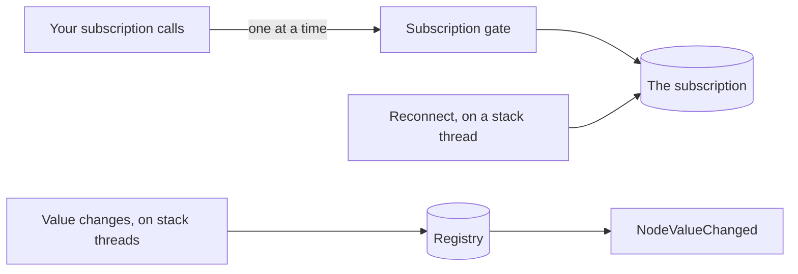

[](https://www.nuget.org/packages/atc.opc.ua)

# Atc.Opc.Ua

A .NET library and CLI tool for OPC UA: connect to servers, read and write nodes, call methods, scan and browse the address space, and monitor values with subscriptions that survive a lost connection.

> Upgrading from 3.x? See [Upgrading to 4.0](#upgrading-to-40).

# Table of Contents

- [Features](#features)
- [Quick Start](#quick-start)
- [OpcUaClient](#opcuaclient)
  - [Dependency injection](#dependency-injection)
  - [Reading nodes](#reading-nodes)
  - [Writing nodes and calling methods](#writing-nodes-and-calling-methods)
  - [Reading enum DataTypes](#reading-enum-datatypes)
  - [Subscriptions](#subscriptions)
    - [How subscriptions work](#how-subscriptions-work)
  - [Configuring security](#configuring-security)
  - [Configuring client options](#configuring-client-options)
  - [Keep-alive and reconnect](#keep-alive-and-reconnect)
  - [Best practices](#best-practices)
- [Browsing the address space](#browsing-the-address-space)
- [Scanning the address space](#scanning-the-address-space)
  - [Comparing two scans](#comparing-two-scans)
- [Samples](#samples)
- [CLI Tool](#cli-tool)
  - [Installation](#installation)
  - [Update](#update)
  - [Usage](#usage)
  - [Scanning from the CLI](#scanning-from-the-cli)
  - [Reading enum DataType definitions](#reading-enum-datatype-definitions)
- [Upgrading to 4.0](#upgrading-to-40)
- [Requirements](#requirements)
- [How to contribute](#how-to-contribute)

# Features

- 🔌 **Connect** anonymously or with a username and password, with a self-signed or your own application certificate.
- 🔄 **Keep-alive and reconnect** in the background when the connection is lost.
- 📖 **Read** variables, objects with their children, and enum DataType definitions.
- ✍️ **Write** variables and **call methods**.
- 🗺️ **Scan** the address space into a tree, and **compare** two scans to find added and removed nodes.
- 🌳 **Browse** the address space one level at a time, e.g. for tree views.
- 🔔 **Subscribe** to nodes and receive their value changes. Subscriptions survive a lost connection.
- 💻 **CLI tool** `atc-opc-ua` for the same operations from a terminal, which keeps itself up to date.

# Quick Start

Connect to an OPC UA server, read a node and disconnect:

```csharp
using Atc.Opc.Ua.Services;
using Microsoft.Extensions.Logging;

using var loggerFactory = LoggerFactory.Create(builder => builder.AddConsole());
using var client = new OpcUaClient(loggerFactory.CreateLogger<OpcUaClient>());

var (connected, connectError) = await client.ConnectAsync(
    new Uri("opc.tcp://opcuaserver.com:48010"),
    CancellationToken.None);

if (!connected)
{
    Console.WriteLine($"Connection failed: {connectError}");
    return;
}

var (succeeded, nodeVariable, readError) = await client.ReadNodeVariableAsync(
    "ns=2;s=Demo.Dynamic.Scalar.Float",
    includeSampleValue: true,
    cancellationToken: CancellationToken.None);

Console.WriteLine(succeeded
    ? $"Value: {nodeVariable!.SampleValue}"
    : $"Read failed: {readError}");

await client.DisconnectAsync(CancellationToken.None);
```

# OpcUaClient

## Dependency injection

After installing the [NuGet package](https://www.nuget.org/packages/atc.opc.ua), register the services:

```csharp
services.AddLogging();
services.AddOptions();

services.AddTransient<IOpcUaClient, OpcUaClient>();
services.AddTransient<IOpcUaScanner, OpcUaScanner>();
services.AddTransient<IOpcUaNodeBrowser, OpcUaNodeBrowser>();
```

Then use them in your services:

```csharp
public sealed class MyService(IOpcUaClient opcUaClient)
{
    public async Task ReadDataAsync(CancellationToken cancellationToken)
    {
        var (connected, connectError) = await opcUaClient.ConnectAsync(
            new Uri("opc.tcp://opcuaserver.com:48010"),
            cancellationToken);

        if (!connected)
        {
            // Handle the error
            return;
        }

        var (succeeded, nodeVariable, readError) = await opcUaClient.ReadNodeVariableAsync(
            "ns=2;s=Demo.Dynamic.Scalar.Float",
            includeSampleValue: true,
            cancellationToken: cancellationToken);

        // Process the data...

        await opcUaClient.DisconnectAsync(cancellationToken);
    }
}
```

## Reading nodes

```csharp
// One variable, with its current value
var (variableRead, variable, variableError) = await client.ReadNodeVariableAsync(
    "ns=2;s=Demo.Dynamic.Scalar.Float",
    includeSampleValue: true,
    cancellationToken: cancellationToken);

// Several variables at once
var (variablesRead, variables, variablesError) = await client.ReadNodeVariablesAsync(
    ["ns=2;s=Demo.Dynamic.Scalar.Float", "ns=2;s=Demo.Dynamic.Scalar.Int32"],
    includeSampleValues: true,
    cancellationToken: cancellationToken);

// An object, with its child objects and variables
var (objectRead, nodeObject, objectError) = await client.ReadNodeObjectAsync(
    "ns=2;s=Demo.Dynamic.Scalar",
    includeObjects: true,
    includeVariables: true,
    includeSampleValues: true,
    cancellationToken: cancellationToken);
```

A variable's `SampleValue` is text formatted with the invariant culture: `21.5`, also on a machine with Danish settings. Date and time values use the round-trip format `O`, e.g. `2026-11-10T20:42:24.0000000Z`. Its type is in `DataTypeOpcUa` and `DataTypeDotnet`.

## Writing nodes and calling methods

```csharp
// One variable. The value's .NET type must match the node's data type, e.g. float for Float.
var (written, writeError) = await client.WriteNodeAsync(
    "ns=2;s=Demo.Dynamic.Scalar.Float",
    100.5f,
    cancellationToken);

// Several variables at once
var (allWritten, writeAllError) = await client.WriteNodesAsync(
    new Dictionary<string, object>(StringComparer.Ordinal)
    {
        ["ns=2;s=Demo.Dynamic.Scalar.Float"] = 100.5f,
        ["ns=2;s=Demo.Dynamic.Scalar.Int32"] = 42,
    },
    cancellationToken);

// A method: the object that has it, the method itself, and its arguments
var (called, results, callError) = await client.ExecuteMethodAsync(
    parentNodeId: "ns=2;s=MyDevice",
    methodNodeId: "ns=2;s=MyDevice.Multiply",
    arguments:
    [
        new MethodExecutionParameter(OpcUaDataEncodingType.Double, "3"),
        new MethodExecutionParameter(OpcUaDataEncodingType.Double, "4"),
    ],
    cancellationToken);
```

## Reading enum DataTypes

The client can read OPC UA enumeration DataType definitions, which is useful for displaying enum options in UIs or mapping numeric values to their symbolic names.

OPC UA enumerations can be defined in two ways:

- **EnumStrings**: a simple `LocalizedText[]` where the array index is the enum value (e.g. `ServerState`).
- **EnumValues**: an `EnumValueType[]` with an explicit Value, Name, DisplayName and Description (e.g. vendor-specific enums).

The client detects and handles both.

```csharp
// One enum DataType
var (enumRead, enumDataType, enumError) = await client.ReadEnumDataTypeAsync(
    "i=852", // ServerState
    cancellationToken);

if (enumRead && enumDataType is not null)
{
    Console.WriteLine($"Enum: {enumDataType.Name} ({enumDataType.Members.Count} members)");

    foreach (var member in enumDataType.Members.OrderBy(x => x.Value))
    {
        Console.WriteLine($"  {member.Value} = {member.Name}");
    }
}

// Several enum DataTypes at once
var (enumsRead, enumDataTypes, enumsError) = await client.ReadEnumDataTypesAsync(
    ["i=852", "ns=3;i=3063"],
    cancellationToken);
```

`OpcUaEnumDataType` contains:

- `NodeId`, `Name`, `DisplayName`, `Description`: the DataType's metadata.
- `HasEnumValues`: `true` when it's defined with EnumValues, `false` for EnumStrings.
- `Members`: the `OpcUaEnumMember`s with `Value`, `Name`, `DisplayName` and `Description`.

## Subscriptions

Monitor node values with a subscription. The client manages the subscription and its monitored nodes, and raises an event for each value change.

```csharp
using var client = new OpcUaClient(logger);
await client.ConnectAsync(serverUri, cancellationToken);

// Receive value changes
client.NodeValueChanged += (sender, e) =>
{
    if (!e.IsGood)
    {
        Console.WriteLine($"{e.DisplayName}: {e.StatusCodeName}");
        return;
    }

    if (e.TryGetValue<double>(out var number))
    {
        Console.WriteLine($"{e.DisplayName} = {number}");
    }
    else
    {
        Console.WriteLine($"{e.DisplayName} = {e.ValueAsText} ({e.DataTypeName})");
    }
};

// One subscription per client; its options apply to every node it monitors
await client.CreateSubscriptionAsync(
    new SubscriptionOptions
    {
        PublishingIntervalMs = 250,
        SamplingIntervalMs = 250,
        QueueSize = 10,
    },
    cancellationToken);

// Monitor one node; it gets a handle
var (_, temperatureHandle, _) = await client.SubscribeToNodeAsync("ns=2;s=Temperature", cancellationToken: cancellationToken);

// Monitor many nodes at once, with a result per node
var (completed, results, subscribeError) = await client.SubscribeToNodesAsync(
    ["ns=2;s=Pressure", "ns=2;s=Flow", "ns=2;s=Level"],
    cancellationToken);

if (!completed)
{
    // The call failed, e.g. without a subscription or when the connection dropped: no node is monitored
    Console.WriteLine($"Subscribing failed: {subscribeError}");
    return;
}

// The call completed: each result says whether its node is monitored
foreach (var rejected in results.Where(x => !x.Succeeded))
{
    Console.WriteLine($"{rejected.NodeId}: {rejected.ErrorMessage}");
}

// ... values arrive through NodeValueChanged ...

// Stop monitoring one node, or all of them
await client.UnsubscribeFromNodeAsync(temperatureHandle, cancellationToken);
await client.UnsubscribeAllAsync(cancellationToken);

// Clean up
await client.RemoveSubscriptionAsync(cancellationToken);
await client.DisconnectAsync(cancellationToken);
```

The `MonitoredNodeValue` of each value change has:

- `MonitoredItemHandle`, `NodeId`, `DisplayName`: which node it is.
- `Value`: the value as a .NET value, e.g. `21.5f` for a Float, `true` for a Boolean or a `DateTime` for a DateTime. A LocalizedText is its text, a NodeId its text form, and a structure its text.
- `TryGetValue<T>`: the value as the type you want. It converts when nothing is lost: a whole number to another integer type it fits in, or any number to `double`. A number with decimals is never converted to an integer.
- `ValueAsText`: the value as text, formatted with the invariant culture (`21.5`, also on a machine with Danish settings). Date and time values use the round-trip format `O`.
- `DataTypeName`, `AccessLevel`: the node's data type (e.g. `Float`) and access level, read once when subscribing.
- `ServerTimestamp`, `SourceTimestamp`: when the value was produced and sent.
- `StatusCode`, `StatusCodeName`, `IsGood`: the value's quality, e.g. `Good` or `BadNodeIdUnknown`. `IsGood` checks the severity, so a Good value with extra information, such as the Overflow bit when the queue dropped values, is still Good.

Good to know:

- **One subscription per client.** Its publishing interval, sampling interval and queue size apply to every node it monitors.
- **Subscribing to a node the server rejects fails,** e.g. with `BadNodeIdUnknown` for a node that doesn't exist. With `SubscribeToNodesAsync`, only that node fails: check each result.
- **Use `SubscribeToNodesAsync` for many nodes.** It needs three round trips to the server, however many nodes there are: one read of the nodes' display names, data types and access levels, one read of data type names it hasn't seen before (usually skipped), and one call that creates all monitored items. Calling `SubscribeToNodeAsync` in a loop costs two or three round trips per node.
- **`NodeValueChanged` is raised on a thread of the OPC UA stack.** Keep handlers short and thread-safe, and hand long work over to another thread.
- **Subscription calls may come from several threads;** they run one at a time.
- **The subscription survives a lost connection,** with the same handles. See [How subscriptions work](#how-subscriptions-work).

### How subscriptions work

| Part | What it is |
|---|---|
| Subscription | One per client, on the server. It has the publishing interval, sampling interval and queue size. |
| Monitored node | A node the subscription watches. The server sends its value changes. |
| Handle | The client's own number for a monitored node, returned by `SubscribeToNodeAsync`. Unique for the client's lifetime. |
| Registry | The client's list of monitored nodes by handle, with the data type and access level read when subscribing. |

The handle belongs to the client, not to the OPC UA stack or the server. That's why it stays the same when the stack replaces its own objects after a reconnect.

**Subscribing and receiving values:**



**After a lost connection.** The client sends keep-alive requests. After a few failed ones (`MaxFailuresBeforeReconnect`), it reconnects:



The registry before and after a server restart:

| Handle | Before: item on the old session | After: item on the new session |
|---|---|---|
| 1 | CurrentTime | CurrentTime, the copy |
| 2 | StepUp | StepUp, the copy |

If the stack couldn't copy the subscription, the client drops it and logs a warning. Call `CreateSubscriptionAsync` again to receive values.

**Threads:**



The [reconnect sample](#samples) shows both reconnect cases against Microsoft's OPC PLC simulator in Docker.

## Configuring security

By default, the `OpcUaClient` creates its own self-signed certificate to present to OPC UA servers. To use your own certificate, configure `OpcUaSecurityOptions`: the certificate stores, the application certificate and other security settings.

> The client creates its certificate stores, including the private key, under `PkiRootPath` relative to the working directory. Keep that folder out of source control, e.g. with `opc/` in `.gitignore`.

The values below are the defaults, except `SubjectName`, which defaults to something like `OpcUaClient [RANDOM_SERIAL_NUMBER]` for the self-signed certificate:

```json
{
  "OpcUaSecurityOptions": {
    "PkiRootPath": "opc/pki",
    "ApplicationCertificate": {
      "StoreType": "Directory",
      "StorePath": "own",
      "SubjectName": "CN=YourApp"
    },
    "RejectedCertificates": {
      "StoreType": "Directory",
      "StorePath": "rejected"
    },
    "TrustedIssuerCertificates": {
      "StoreType": "Directory",
      "StorePath": "issuers"
    },
    "TrustedPeerCertificates": {
      "StoreType": "Directory",
      "StorePath": "trusted"
    },
    "AddAppCertToTrustedStore": true,
    "AutoAcceptUntrustedCertificates": false,
    "MinimumCertificateKeySize": 1024,
    "RejectSha1SignedCertificates": true,
    "RejectUnknownRevocationStatus": true
  }
}
```

```csharp
services
    .AddOptions<OpcUaSecurityOptions>()
    .Bind(configuration.GetRequiredSection(nameof(OpcUaSecurityOptions)))
    .ValidateDataAnnotations()
    .ValidateOnStart();

services.AddTransient<IOpcUaClient, OpcUaClient>();
```

Connecting with a username and password:

```csharp
var (connected, connectError) = await opcUaClient.ConnectAsync(
    new Uri("opc.tcp://opcuaserver.com:48010"),
    userName: "myuser",
    password: "mypassword",
    cancellationToken);
```

## Configuring client options

`OpcUaClientOptions` sets the client application's name and the OPC UA session timeout:

```json
{
  "OpcUaClientOptions": {
    "ApplicationName": "MyOpcUaClientApp",
    "SessionTimeoutMilliseconds": 1800000
  }
}
```

```csharp
services
    .AddOptions<OpcUaClientOptions>()
    .Bind(configuration.GetRequiredSection(nameof(OpcUaClientOptions)))
    .ValidateDataAnnotations()
    .ValidateOnStart();
```

The defaults are `ApplicationName` = `OpcUaClient` and `SessionTimeoutMilliseconds` = 1,800,000 (30 minutes).

## Keep-alive and reconnect

The client watches the connection with OPC UA keep-alive requests. After a number of failed requests in a row, it reconnects in the background. Tune or turn this off with `OpcUaClientKeepAliveOptions`; the values below are the defaults:

```json
{
  "OpcUaClientKeepAliveOptions": {
    "Enable": true,
    "IntervalMilliseconds": 15000,
    "MaxFailuresBeforeReconnect": 3,
    "ReconnectPeriodMilliseconds": 10000
  }
}
```

```csharp
services
    .AddOptions<OpcUaClientKeepAliveOptions>()
    .Bind(configuration.GetRequiredSection(nameof(OpcUaClientKeepAliveOptions)))
    .ValidateDataAnnotations()
    .ValidateOnStart();
```

What gets logged:

- **Warning** for each failed keep-alive request until a reconnect starts, and when the reconnect starts.
- **Information** when the session is reconnected, when keep-alive requests succeed again without a reconnect, and when a subscription is restored on a new session.

## Best practices

- **Pass a `CancellationToken`** to every call. Use `CancellationToken.None` only for work that mustn't be cancelled.

  ```csharp
  using var cts = new CancellationTokenSource(TimeSpan.FromSeconds(30));
  await client.ConnectAsync(serverUri, cts.Token);
  ```

- **Dispose the client**, e.g. with `using`, to release the session and its resources.

- **Check `Succeeded`** of every call:

  ```csharp
  var (succeeded, nodeVariable, error) = await client.ReadNodeVariableAsync(
      nodeId,
      includeSampleValue: true,
      cancellationToken: cancellationToken);

  if (!succeeded)
  {
      logger.LogError("Read failed: {Error}", error);
  }
  ```

- **Disconnect explicitly** with `DisconnectAsync` before disposing, for a clean shutdown.

- **Reuse a connected client** for many operations, instead of creating a new one each time.

# Browsing the address space

`IOpcUaNodeBrowser` browses the address space one level at a time, e.g. for a tree view that loads as it expands. It uses a connected `IOpcUaClient`. To read a whole part of the address space at once, see [Scanning the address space](#scanning-the-address-space).

```csharp
var browser = new OpcUaNodeBrowser(browserLogger);

// The children of the Objects folder
var (browsed, children, browseError) = await browser.BrowseChildrenAsync(
    client,
    "i=85",
    cancellationToken);

foreach (var child in children!)
{
    Console.WriteLine($"{child.DisplayName} ({child.NodeClass}) HasChildren={child.HasChildren}");
}

// All attributes of one node
var (attributesRead, attributes, attributesError) = await browser.ReadNodeAttributesAsync(
    client,
    "ns=2;s=Temperature",
    cancellationToken);

Console.WriteLine($"Value: {attributes!.Value}, Writable: {attributes.IsWritable}");
```

# Scanning the address space

`IOpcUaScanner` reads a part of the address space into a tree: a starting object with its child objects and variables.

```csharp
var scanner = new OpcUaScanner(loggerFactory.CreateLogger<OpcUaScanner>());

var result = await scanner.ScanAsync(
    client,
    new OpcUaScannerOptions
    {
        StartingNodeId = "ns=2;s=Demo.Dynamic.Scalar",
        ObjectDepth = 2,
        VariableDepth = 1,
        IncludeSampleValues = true,
    },
    cancellationToken);

if (result.Succeeded)
{
    // result.Root is the starting object, with its child objects and variables
}
```

| Option | Default | Description |
|---|---|---|
| `StartingNodeId` | the Objects folder (`i=85`) | Where the scan starts. |
| `ObjectDepth` | 100 | How many levels of child objects to follow. |
| `VariableDepth` | 100 | How many levels of child variables to follow. |
| `IncludeSampleValues` | `false` | Read each variable's current value into `SampleValue`. |
| `IncludeObjectNodeIds`, `ExcludeObjectNodeIds` | empty | Objects to scan, or to skip. |
| `IncludeVariableNodeIds`, `ExcludeVariableNodeIds` | empty | Variables to scan, or to skip. |

The filters are applied while the scan runs, so skipped branches are never browsed. When a node is both included and excluded, it's excluded. An include list works as an allow-list: nodes not on it are skipped.

## Comparing two scans

`NodeTreeDiffer` compares two scans by NodeId, e.g. to find the nodes a server added or removed since the last scan:

```csharp
var comparison = NodeTreeDiffer.Diff(currentScan.Root, previousScan.Root);

// comparison.AddedNodes, comparison.DeletedNodes and comparison.UnchangedNodes
```

# Samples

| Sample | Shows |
|---|---|
| `sample/Atc.Opc.Ua.Sample` | Reading enum DataTypes, scanning with a variable filter, and reading variables on a timer with reconnect. |
| `sample/Atc.Opc.Ua.Subscription.Sample` | Browsing, reading attributes, subscribing and unsubscribing. |
| `sample/Atc.Opc.Ua.Reconnect.Sample` | A subscription surviving a frozen and a restarted server. |

The first two connect to a local server at `opc.tcp://127.0.0.1:49320`. The reconnect sample uses Microsoft's OPC PLC simulator in Docker:

```powershell
docker run -d --name opcplc -p 50000:50000 mcr.microsoft.com/iotedge/opc-plc:2.15.11 --pn=50000 --autoaccept --ut --ph=localhost
dotnet run --project sample/Atc.Opc.Ua.Reconnect.Sample -- --docker
```

With `--docker`, it freezes and restarts the container itself, and checks that the values come back and that unsubscribing and removing still work. Without it, it monitors until Ctrl+C, and you run `docker pause opcplc`, `docker unpause opcplc` or `docker restart opcplc` yourself.

# CLI Tool

`atc-opc-ua` is a cross-platform command-line tool for the same operations.

## Installation

Install it as a .NET global tool; it needs the .NET 10 runtime:

```powershell
dotnet tool install --global atc-opc-ua
```

Or follow the instructions on [NuGet](https://www.nuget.org/packages/atc-opc-ua/) to install a specific version.

## Update

The CLI keeps itself up to date. When a command starts, it checks NuGet for a newer version, at most once a day. When there is one, it runs `dotnet tool update --global atc-opc-ua` itself, and the new version is used from the next run. If that fails, it prints the command to run yourself:

```powershell
dotnet tool update --global atc-opc-ua
```

To skip the check, add `--no-update-check` to the command, or set `ATC_OPC_UA_NO_UPDATE_CHECK=1`. It never runs on CI, i.e. when `CI`, `TF_BUILD` or `GITHUB_ACTIONS` is set.

## Usage

Run `atc-opc-ua --help` for the commands; every command has its own `--help` too:

```powershell
atc-opc-ua --help

USAGE:
    atc-opc-ua.exe [OPTIONS] <COMMAND>

EXAMPLES:
    atc-opc-ua.exe testconnection -s opc.tcp://opcuaserver.com:48010
    atc-opc-ua.exe testconnection -s opc.tcp://opcuaserver.com:48010 -u username -p password
    atc-opc-ua.exe testconnection -s opc.tcp://opcuaserver.com:48010 --no-update-check
    atc-opc-ua.exe node scan -s opc.tcp://opcuaserver.com:48010 --starting-node-id "ns=2;s=Demo.Dynamic.Scalar" --object-depth 2 --variable-depth 1
    atc-opc-ua.exe method execute -s opc.tcp://opcuaserver.com:48010 --parent-node-id "ns=2;s=Demo.Method" --method-node-id "ns=2;s=Demo.Method.Multiply" --data-types double --data-values 3 --data-types double --data-values 4

OPTIONS:
    -h, --help    Prints help information

COMMANDS:
    testconnection    Tests if a connection can be made to a given server
    node              Operations related to nodes
    method            Operations related to methods
```

Every command, with an example. Add `-u <username> -p <password>` to any of them to connect with a username:

| Command | What it does |
|---|---|
| `testconnection` | Tests if a connection can be made to the server. |
| `node read object` | Reads an object with its child objects and variables. |
| `node read variable single` / `multi` | Reads one or more variables. |
| `node read datatype single` / `multi` | Reads one or more enum DataType definitions. |
| `node write variable single` | Writes a value to a variable. |
| `node scan` | Scans part of the address space into a tree. |
| `method execute` | Calls a method with arguments. |

```powershell
atc-opc-ua testconnection -s opc.tcp://opcuaserver.com:48010
atc-opc-ua node read object -s opc.tcp://opcuaserver.com:48010 -n "ns=2;s=Demo.Dynamic.Scalar"
atc-opc-ua node read variable single -s opc.tcp://opcuaserver.com:48010 -n "ns=2;s=Demo.Dynamic.Scalar.Float"
atc-opc-ua node read variable multi -s opc.tcp://opcuaserver.com:48010 -n "ns=2;s=Demo.Dynamic.Scalar.Float" -n "ns=2;s=Demo.Dynamic.Scalar.Int32"
atc-opc-ua node read datatype single -s opc.tcp://opcuaserver.com:48010 -n "i=852"
atc-opc-ua node write variable single -s opc.tcp://opcuaserver.com:48010 -n "ns=2;s=Demo.Dynamic.Scalar.Float" -d float --value "100.5"
atc-opc-ua node scan -s opc.tcp://opcuaserver.com:48010 --starting-node-id "ns=2;s=Demo.Dynamic.Scalar" --object-depth 2 --variable-depth 1
atc-opc-ua method execute -s opc.tcp://opcuaserver.com:48010 --parent-node-id "ns=2;s=Demo.Method" --method-node-id "ns=2;s=Demo.Method.Multiply" --data-types double --data-values 3 --data-types double --data-values 4
```

## Scanning from the CLI

`node scan` builds the object and variable tree from a starting node (default: the Objects folder):

```powershell
atc-opc-ua node scan -s opc.tcp://opcuaserver.com:48010 --starting-node-id "ns=2;s=Demo.Dynamic.Scalar" --object-depth 2 --variable-depth 1 --include-sample-values
```

Key options:

- `--starting-node-id`: the starting object (the Objects folder when omitted or empty).
- `--object-depth`: how deep to follow objects (0 = only the starting object). Default 1.
- `--variable-depth`: how deep to follow nested variables (0 = only direct variables). Default 0.
- `--include-sample-values`: read a value for each variable.
- `--include-object-node-id`, `--exclude-object-node-id`: objects to scan, or to skip. Repeatable.
- `--include-variable-node-id`, `--exclude-variable-node-id`: variables to scan, or to skip. Repeatable.

The filters work as in [Scanning the address space](#scanning-the-address-space). For example, only one variable, and skipping an object:

```powershell
atc-opc-ua node scan -s opc.tcp://opcuaserver.com:48010 --starting-node-id "ns=2;s=Demo.Dynamic.Scalar" --include-variable-node-id "ns=2;s=Demo.Dynamic.Scalar.Float" --exclude-object-node-id "ns=2;s=Unwanted.Object"
```

## Reading enum DataType definitions

```powershell
# One enum DataType (e.g. ServerState)
atc-opc-ua node read datatype single -s opc.tcp://opcuaserver.com:48010 -n "i=852"

# Several enum DataTypes
atc-opc-ua node read datatype multi -s opc.tcp://opcuaserver.com:48010 -n "i=852" -n "ns=3;i=3063"
```

The output is a table of the enum's members with their Value, Name, DisplayName and Description.

# Upgrading to 4.0

4.0 requires .NET 10, adds subscriptions and address space browsing, and changes how values are formatted and how reconnects are logged. Go through this list when you upgrade from 3.x.

## Changes that need code changes

**.NET 10 is required.** 4.0 targets `net10.0` (3.x targeted `net9.0`). The CLI tool needs the .NET 10 runtime.

**Your own implementations of `IOpcUaClient`** get new members: `Session`, `NodeValueChanged`, `CreateSubscriptionAsync`, `RemoveSubscriptionAsync`, `SubscribeToNodeAsync`, `SubscribeToNodesAsync`, `UnsubscribeFromNodeAsync` and `UnsubscribeAllAsync`. Add them to your implementation. Mocks, e.g. with NSubstitute, need no change.

## Changes in behaviour

**Sample values use the invariant culture.** In 3.x, `NodeVariable.SampleValue` was formatted with the machine's culture, e.g. `21,5` on Danish settings. In 4.0 it's `21.5` everywhere, and date and time values use the round-trip format `O`, e.g. `2026-11-10T20:42:24.0000000Z`. An app that runs with the invariant culture, as containers usually do, only sees the change for dates and times.

**The CLI updates itself.** When a command starts, it checks NuGet for a newer `atc-opc-ua` once a day, and installs it with `dotnet tool update --global`. Add `--no-update-check` to skip it. See [Update](#update). It also prints a new startup banner instead of the text header.

**Keep-alive and reconnects are logged at Warning and Information.** In 3.x, failed keep-alive requests and reconnects were logged at Trace, so they didn't show by default. See [Keep-alive and reconnect](#keep-alive-and-reconnect).

# Requirements

- [.NET 10 SDK](https://dotnet.microsoft.com/en-us/download/dotnet/10.0)
- [OPCFoundation.NetStandard.Opc.Ua](https://www.nuget.org/packages/OPCFoundation.NetStandard.Opc.Ua) 1.5.377.21

# How to contribute

[Contribution Guidelines](https://atc-net.github.io/introduction/about-atc#how-to-contribute)

[Coding Guidelines](https://atc-net.github.io/introduction/about-atc#coding-guidelines)
